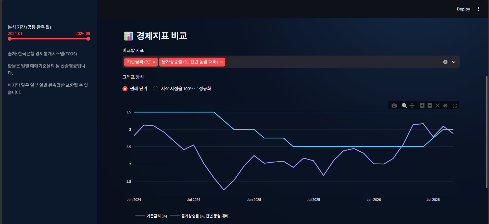

# 📈 MoneyScope Korea

**한국의 기준금리·소비자물가상승률·원/달러 환율을 탐색하고 비교하는 금융 데이터 분석 대시보드**

한국은행 경제통계시스템(ECOS)의 시계열 데이터를 Python으로 수집·가공하고, Streamlit에서 시각화하는 개인 학습 프로젝트입니다. 경제지표의 변화와 관계를 다양한 관점에서 **탐색**할 수 있도록 만들었습니다.

> **주의:** 이 프로젝트는 경제 통계의 기술적·탐색적 분석을 위한 학습용 도구입니다. 지표 간 상관관계 또는 금리 변경 전후 환율 변화를 인과관계나 투자 조언으로 해석해서는 안 됩니다.

## 주요 기능

| 메뉴 | 제공 기능 |
| --- | --- |
| 📈 경제 현황 | 최근 관측값 및 관측일, 기간 선택, 지표별 시계열 비교, 시작값=100 정규화 |
| 🔎 상관관계·통계 | 피어슨 상관계수, 월별 변화량 히트맵, 평균·최고·최저·변동성 |
| 🗓️ 금리 이벤트 | 기준금리 **변경 월** 탐지 및 변경 전월/다음 달의 환율 월평균 비교 |
| 📊 과거 국면 비교 | 서로 다른 두 연도의 월별 추이, 상세 통계 비교 |
| 📝 분석 리포트 | 시작·종료값 비교, 최고·최저 시점, 월별 변화 통계, TXT 다운로드 |

CSV 데이터 내보내기 기능도 제공합니다.

## 화면 미리보기



## 기술 스택

- **Python** — 데이터 처리 및 분석 로직
- **Pandas** — 시계열 정렬, 결합, 월평균, 통계 계산
- **Streamlit** — 웹 대시보드 및 사용자 입력
- **Plotly** — 일부 대화형 그래프
- **Requests** — 한국은행 ECOS API 호출
- **Git / GitHub** — 버전 관리 및 프로젝트 공개

## 프로젝트 구성

```text
moneyscope-korea/
├── app.py                  # Streamlit UI와 화면 흐름
├── data_loader.py          # ECOS API 데이터 조회
├── analysis.py             # 월별 데이터 결합 및 변화율·상관관계
├── descriptive_stats.py    # 상세 기술통계
├── event_analysis.py       # 기준금리 변경 월 / 환율 비교
├── period_comparison.py    # 두 기간 데이터 추출
├── report.py               # 기본 텍스트 리포트
├── advanced_report.py      # 심화 텍스트 리포트
├── requirements.txt
├── .gitignore
└── .streamlit/
    └── secrets.toml        # 개인 인증키: Git에 업로드 금지
```

## 로컬 실행 (Windows PowerShell)

Python이 설치되어 있는지 확인한 다음, `requirements.txt`와 `app.py`가 있는 프로젝트 폴더에서 실행합니다.

```powershell
python -m venv .venv
.\.venv\Scripts\Activate.ps1
python -m pip install -r requirements.txt
```

PowerShell 실행 정책에 막히면 CMD에서 `.venv\Scripts\activate.bat`를 사용하거나 PowerShell의 현재 프로세스에 한해 실행 정책을 설정할 수 있습니다.

한국은행 [ECOS](https://ecos.bok.or.kr/)에서 발급받은 API 인증키를 `.streamlit/secrets.toml` 파일에 저장합니다.

```toml
ECOS_API_KEY = "발급받은_인증키"
```

그다음 웹 앱을 실행합니다.

```powershell
python -m streamlit run app.py
```

브라우저에서 `http://localhost:8501`에 접속합니다.

**보안:** `.streamlit/secrets.toml`, `.env`, `.venv/` 등은 `.gitignore`에서 제외해야 합니다. 인증키를 코드·커밋·스크린샷에 포함하지 마세요.

## 데이터 출처와 처리 방식

**출처: 한국은행 경제통계시스템(ECOS)**

| 지표 | 조회 통계 코드 | 데이터 처리 |
| --- | --- | --- |
| 한국 기준금리 | `722Y001` / `0101000` | 월별 관측값 |
| 원/달러 매매기준율 | `731Y001` / `0000001` | 일별 값을 월 산술평균으로 변환 |
| 소비자물가지수 | `901Y009` / `0` | 월별 CPI를 이용해 전년 동월 대비 상승률 계산 |

물가상승률 계산식:

```text
물가상승률(%) = (당월 CPI / 12개월 전 CPI - 1) × 100
```

- 공통 월을 기준으로 데이터를 결합하므로, 지표의 발표 시점과 최근 관측일은 다를 수 있습니다.
- 환율 월평균의 첫 달·마지막 달은 일부 날짜만 포함된 평균일 수 있습니다.
- 월별 기준금리 변화 탐지는 **정확한 금융통화위원회 결정일을 식별하는 기능이 아닙니다.**
- 통계 코드와 API 응답 형식은 운영기관의 변경에 따라 달라질 수 있습니다.

## 분석 시 주의할 점

- **상관관계는 인과관계를 뜻하지 않습니다.** 특히 시계열 수준값에는 공통 추세가 있을 수 있습니다.
- 기준금리·물가상승률은 % 또는 %p, 환율은 원 또는 %로 단위가 다릅니다.
- 금리 이벤트 분석은 변경 월을 제외한 전월과 다음 달을 비교하는 탐색적 분석입니다.
- 이 프로젝트는 미래 환율이나 경제지표를 예측하지 않습니다.

## 향후 개선 계획

- API 응답 및 결측치에 대한 자동화 테스트
- 통계 산출 결과를 공식 발표 수치와 대조하는 검증 절차
- 화면 및 접근성 개선
- Streamlit Community Cloud 배포

## 개발 목적

Python·Pandas를 이용한 금융 시계열 처리, 외부 API 연동, 기술통계, Streamlit 대시보드 개발 및 Git 버전 관리를 직접 학습하고 기록하기 위해 제작했습니다.
